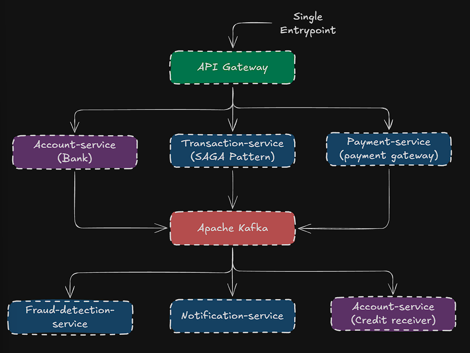
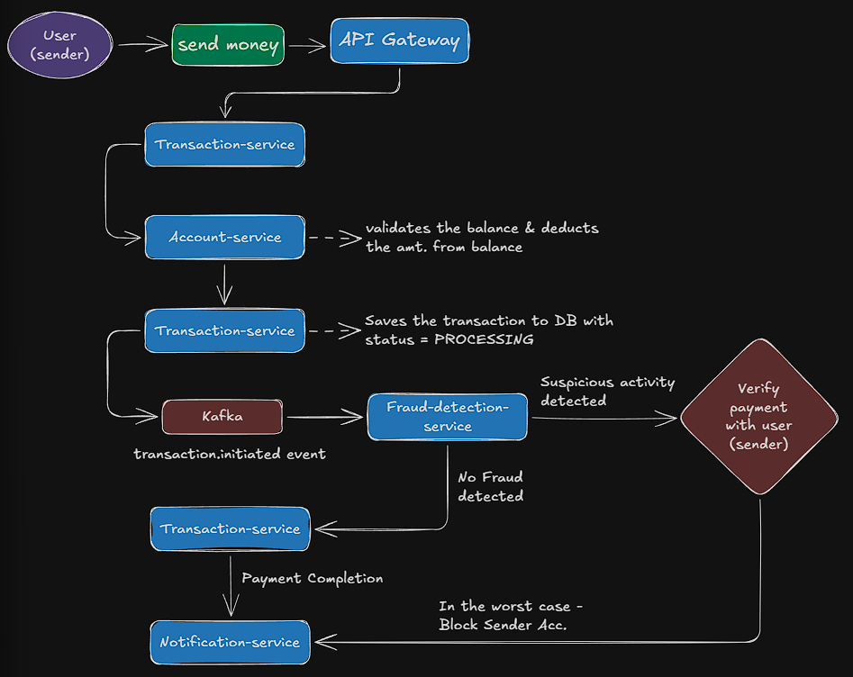

# Online-Banking-System-Microservices
Online Banking System Microservices with integrated payment gateway

## HLD Architecture

## Flow of Money: Workflow Diagram

## SAGA Pattern
**Case**: Consider the following scenario.
- Step 1: User orders a product -> order arrives -> user pays via C.O.D.
- Step 2: Users opens the box -> Sees a Damaged product.
- Step 3: User wants to return the product & initiate refund.

*The Question being - Is **Step 3** a separate, standalone new step/process, or does it only mean reverting/rolling back Steps 1, 2.*

### Traditional Monolithic pattern:
It follows: **BEGIN -> COMMIT -> ROLLBACK** pattern. All changes to DB made in steps 1, 2 are rolled back to return the product & refund the user (like rolling back total products count, user balance, etc.). The DB doesn't hold any history of the steps involved in the full scenario.

### SAGA Pattern:
**Step 3 is a separate, standalone process** involving different services of the system. The goal is **undoing Steps 1, 2** by subsequent tasks in Steps 3, **not direct DB Rollback**. The DB holds full history of the 3-step scenario.

### Summary:
**SAGA Pattern**: A way to maintain data consistency across microservices without distributed ACID transactions. A business workflow is split into a sequence of local transactions, one per service, each committing independently. If a step fails, previously completed steps are undone by compensating transactions (e.g., refund payment, release inventory) rather than a DB rollback.

**Example**: Transfer ₹X: Debit Account A → Credit Account B. If crediting B fails, a compensating “reverse debit” restores A. This fits your banking project far better than the COD return.

**Monolith vs SAGA**: A monolith gets atomicity and isolation from one DB transaction. SAGA trades that for availability and service autonomy, accepting eventual consistency.

**Styles**: Choreography (event-driven) vs Orchestration (coordinator).

### Important pointers for SAGA
- Why SAGA exists: database-per-service means you can’t have one ACID transaction across services.
- The two coordination styles: choreography (services react to events, e.g. via Kafka) and orchestration (a central coordinator directs steps).
- Compensations aren’t true rollbacks. They’re semantic undos, and some actions can’t be undone (e.g., a sent email), which is why step ordering matters.
- Idempotency requirements for compensations and retries.
- Lack of isolation: other transactions can see intermediate state.